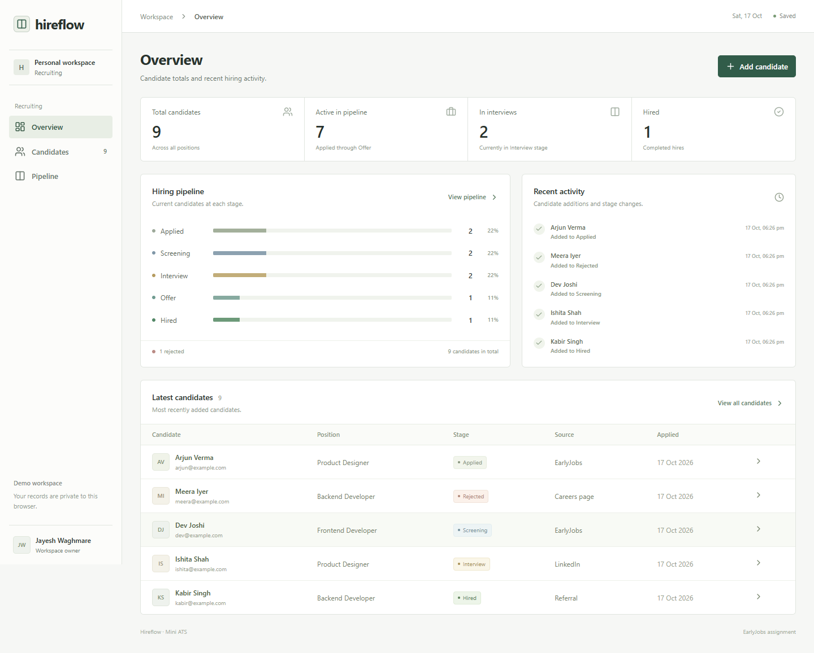

# Hireflow — Mini Applicant Tracking System

A responsive ATS for the EarlyJobs assignment. Manage candidates and hiring stages, search profiles, and see dashboard metrics update from real data.

## Submission links
- [Vercel production application](https://hireflow-mini-ats-kappa.vercel.app)
- [Live application](https://hireflow-jayesh-ats.active-seed-2151.chatgpt.site)
- [GitHub repository](https://github.com/Jayesh-Waghmare/hireflow-mini-ats)
- [Short captioned demo](https://github.com/Jayesh-Waghmare/hireflow-mini-ats/releases/download/v1.1.0/Hireflow-demo.webm)

## Interface


## Features
- Candidate create, view, edit and delete with validation and duplicate email protection.
- Applied, Screening, Interview, Offer, Hired and Rejected stages.
- Drag-and-drop pipeline and accessible stage dropdown.
- Search names, emails, roles, skills and locations. Combine role and stage filters.
- Live totals, active candidates, interviews, hires and stage distribution.
- Recruiter notes, source, experience and timestamped stage history.
- CSV export with spreadsheet formula escaping.
- Opt-in fictional sample data, loading/error/empty states, responsive layouts.
- Cloudflare D1 persistence. An HttpOnly cookie isolates each visitor's workspace.

## Stack
React 19, TypeScript, Vinext (Next.js App Router compatible), Cloudflare Workers, Drizzle ORM, SQLite/D1, Zod and Lucide. Server routes validate writes; database queries are parameterized.

## Run locally
Requires Node.js >=22.13 and npm.

```sh
npm run install:ci
npm run build
node --import ./scripts/sites-env.mjs ./node_modules/wrangler/bin/wrangler.js d1 execute DB --local --config dist/server/wrangler.json --persist-to .wrangler/state --file drizzle/0000_odd_mantis.sql
npm run dev
```
Apply migrations once in order. The server prints its local URL (usually port 5173). Sites applies production migrations during deployment.

## Verify
```sh
node --experimental-strip-types --test tests/model.test.ts
npx tsc --noEmit
```

## API
GET /api/candidates initializes a workspace cookie and lists its records. POST creates a record, or updates one when id is supplied. DELETE /api/candidates?id=... removes a record within the current workspace. Errors return JSON and HTTP status codes. Responses are not cached. Cross-origin browser mutations are rejected.

## Demo workflow
1. Load fictional sample candidates from the dashboard.
2. Add and open a candidate.
3. Search by skill and combine role and stage filters.
4. Move candidates through the pipeline and inspect history.
5. Edit notes and refresh to verify persistence.
6. Review dashboard metrics, export CSV and delete a test record.

## Scope and tradeoffs
This is an assignment demo. Anonymous workspaces let reviewers explore independently. Clearing cookies or switching browsers creates a new workspace; there is no cross-device login or shared team access. Workspaces have a 500-candidate limit. Authentication, roles, pagination, resume uploads, scheduling, rate limiting and retention are future production work. Use fictional data on the public demo.

Active means Applied through Offer. Stage percentages use all candidates as denominator. Sample data is opt-in. Timestamps are UTC and displayed in the visitor's locale.


## Browser checks and recording
The optional tests/browser.mjs suite uses Playwright and an installed Chrome browser. Install Playwright separately to run it. Set BASE_URL to a running local server; DEMO_OUTPUT chooses the artifact folder. It records a captioned WebM demo and checks CRUD, filtering, stage movement, CSV, persistence, isolation and mobile overflow.


## Vercel target
See [Vercel deployment documentation](docs/VERCEL.md) for the shared React build, Vercel function, and persistent API architecture. Run npm run build:vercel to build this target. Vercel hosts the frontend and API gateway; candidate storage stays in the original Cloudflare D1 backend.


